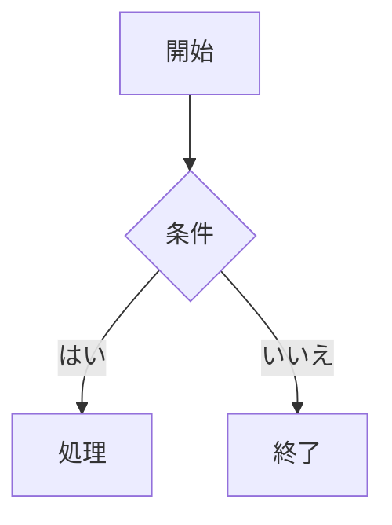

---
title = "編集の基本"
---

## ファイルを開く

上段の「ファイル」→「開く」から Markdown ファイルを選びます。複数のファイルを開くと、タブを切り替えながら編集できます。

Linux のデスクトップ版では「ファイル」→「フォルダを開く」も使えます。開いたフォルダは「ファイル」→「最近開いたフォルダ」に記録され、次回から選んで開けます。サイドバーのファイル名をクリックすると、プレビュー用のタブで開きます。別のファイルをクリックすると同じタブを使い回します。編集を始めると、そのタブは固定されます。ファイルを右クリックして「新しいタブで開く」を選ぶと、最初から固定タブで開けます。

## ファイルを名前で探す

`Ctrl + Shift + P` を押すと、ファイル名で探す窓が開きます。名前の一部を入力すると候補が絞り込まれ、`Enter` で開きます。最近開いたファイルと、開いているフォルダ内の Markdown ファイル（サブフォルダを含む）が対象です。

## フォルダ内を検索する

`Ctrl + Shift + F`、またはサイドバーの「検索」タブで、開いているフォルダ内の Markdown ファイルをまとめて検索します。結果はファイルごとに並び、行をクリックするとそのファイルを開いて該当箇所へ移動します。「Aa」で大文字・小文字の区別、「.*」で正規表現の使用を切り替えます。

リンクの URL など、プレビューに表示されない部分に一致した場合は、ソース表示で確認してください。

## ファイルへのリンクを入れる

フォルダを開いているときに本文で `[[` と入力すると、リンクするファイルを選ぶ窓が開きます。選んだファイルへのリンクが、文書から見た相対パスで入ります（例：`[設計書](../design/設計書.md)`）。`Esc` で閉じると `[[` がそのまま残ります。本文の右クリックメニューの「ファイルへのリンクを挿入…」からも使えます。相対パスを計算するため、文書を一度保存してから使ってください。

サイドバーの「リンク」タブには、開いているフォルダの中で、いま表示している文書へリンクしている文書と、その行が表示されます。クリックするとリンク元の文書を開きます。

## 表示モードを選ぶ

- **プレビュー編集**：見出しや表など、整形された見た目のまま文章を編集します。
- **分割**：Markdown のソースとプレビューを並べて表示します。
- **ソース**：Markdown の記号を含めて、テキストを直接編集します。

ツールバーのボタン、または `Ctrl + /` で切り替えられます。

## 集中モードを使う

`Ctrl + Shift + Enter`、またはツールバーの集中モードのボタンで切り替えます。ツールバー・サイドバー・タブ・ステータスバーを隠し、本文を中央に表示します。プレビュー編集では、カーソルのある段落（リストや表はその全体）以外を薄く表示します。もう一度 `Ctrl + Shift + Enter` を押すか、右上の「集中モードを終了」で元に戻ります。

## フォントを選ぶ

下段の「設定」から「本文のフォント」を選びます。丸ゴシック、ゴシック、明朝、システム標準、IPA ゴシック、IPA 明朝、等幅を選べます。本文の文字サイズも変更できます。設定は次回起動時にも引き継がれます。フォントと文字サイズの変更はプレビュー本文の表示だけに適用され、Markdown ファイルの内容やソース表示は変わりません。

同じ設定画面で、ライト、ペーパー、セピア、ダーク、グラファイト、ディープブルーのテーマを選べます。「システムに合わせる」では OS の明暗設定に従います。

## タブを操作する

タブはドラッグして並べ替えられます。`Ctrl + Tab` で次のタブへ、`Ctrl + Shift + Tab` で前のタブへ移動します。

タブの「×」または `Ctrl + W` で閉じます。マウスの中ボタンでタブをクリックして閉じることもできます。

## 表を編集する

表のセルでは `Tab` で次のセルへ移動します。右クリックのメニューから、行や列の追加・削除、文字の配置変更ができます。

Excel などでコピーしたセル範囲を貼り付けると、表として取り込めます。

## コピー・貼り付け

プレビュー編集の本文を右クリックすると、切り取り・コピー・貼り付け、太字などの書式、文字の色、リンクを開く操作のメニューが出ます（表のセルでは表のメニュー、コードブロックでは標準のメニューになります）。

通常のコピーでは Markdown の書式（太字の `**` や文字色の指定など）も一緒にコピーします。文字だけが欲しいときは `Ctrl + Shift + C`（書式なしでコピー）を使います。貼り付けでは Markdown の記号やタブ区切りの表を解釈しますが、`Ctrl + Shift + V`（書式なしで貼り付け）ではそのままの文字として入れます。

## 図を描く（Mermaid）

コードブロックの言語を `mermaid` にすると、内容を図として表示します。

````markdown

````

図はコードの下のプレビュー欄に表示され、HTML や PDF への書き出しにも含まれます。書き方に誤りがある場合は、プレビュー欄にエラーの内容を表示します。図はテーマにかかわらず白い背景で表示します。

## 画像を挿入する

画像を貼り付けるか、画像ファイルを編集画面へドラッグします。デスクトップ版では、Markdown ファイルと同じフォルダにある `images/` に画像を保存します。文書をまだ保存していない場合は、先に保存先を選びます。

画像にマウスを乗せると右下に四角いつまみが出ます。ドラッグすると表示幅を変えられ、ダブルクリックで元の大きさに戻ります。幅は代替テキストの末尾に `` の形で保存します（Obsidian と同じ書き方です）。ほかの Markdown ビューアでは、この幅は反映されません。幅を変えられるのは、画像だけの段落にある画像です。

画像を含む文書を移動するときは、`images/` も一緒に移動してください。

## 文章を検索・置換する

`Ctrl + F` で検索、`Ctrl + H` で検索と置換を開きます。「Aa」で大文字・小文字の区別、「.*」で正規表現の使用を切り替えます。

検索欄で `Enter` を押すと次の結果へ、`Shift + Enter` で前の結果へ移動します。置換欄では `Enter` で現在の一致箇所を置換し、`Ctrl + Enter` ですべて置換します。

## 文書の情報を確認する

画面下部に文字数、行数、語数、読了時間の目安を表示します。チェックリストがある場合は、完了した項目数と全体の項目数も表示します。語数と読了時間は簡易的な計算による目安です。

## チャットを使う

デスクトップ版の右上にある「チャット」を押すと、右側にパネルが開きます。現在の接続先は Claude です。アプリの「設定」を開き、Claude Console の API キーを入力して「保存する」を押してください。キーは Linux のシステムキーチェーンに保存され、次回起動時にも使えます。設定の「保存したキーを削除」で消去できます。「今回だけ使う」を選んだ場合はアプリ終了時に消去されます。キーチェーンを利用できない環境でも一時利用はできます。環境変数 `ANTHROPIC_API_KEY` も利用できます。

質問するときは「送信」、文書を直したいときは「変更案を作る」を押します。変更案では、生成された Markdown 全体を確認してから「文書に適用」を押してください。文書を編集中に変更案を受け取った場合は、古い案を適用できないようにしています。送信時には現在の文書全体が Claude API に渡され、設定したキーの所属組織のクレジットを使用します。

フォルダを開いて「フォルダを調べて実行」を押すと、エージェントがフォルダ内の Markdown を一覧・検索・読込して作業します。未保存の文書があれば先に保存してください。変更案や新しい文書はファイルごとの差分に表示されます。適用するファイルを選んで「選択した変更を適用」を押すまで、ファイルは変更されません。エージェントが扱えるのは開いたフォルダ内の Markdown とテキストだけで、シェル操作はできません。

## 文書のメタデータを編集する

文書の先頭に `---` で囲んだ YAML frontmatter を置くと、タイトルなどの情報を本文と分けて保持できます。

```yaml
---
title: 作業メモ
tags:
  - メモ
---
```

この部分はプレビュー編集には表示されません。編集するときはソースモードに切り替えてください。本文を編集して保存しても、先頭のメタデータは保持されます。
